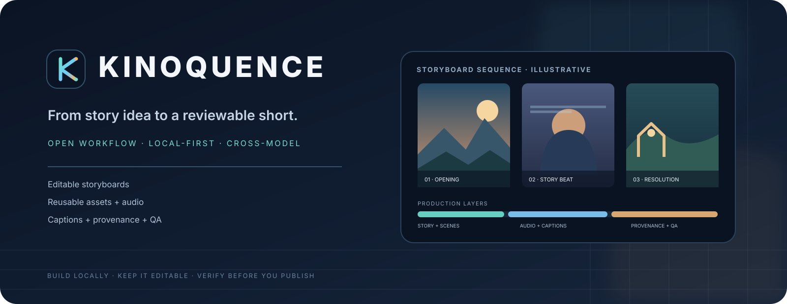
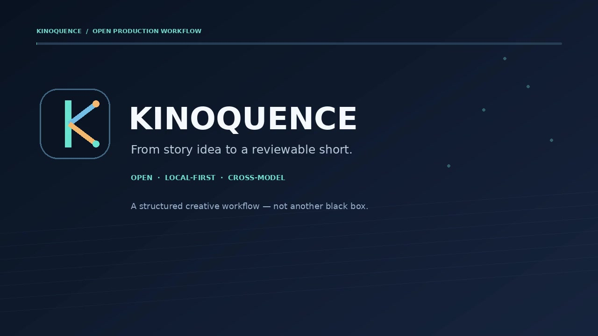
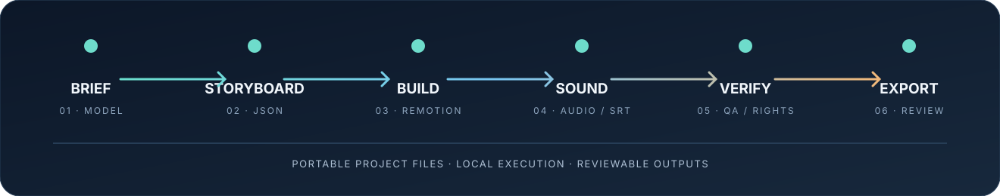
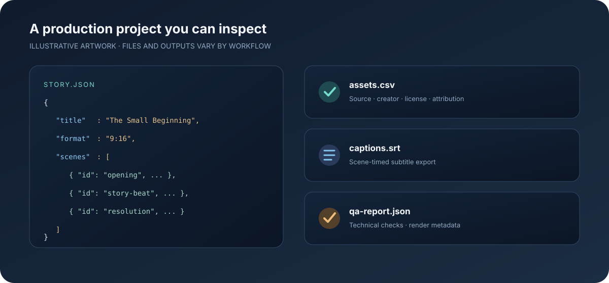

<div align="center">



# Kinoquence

### Direct the story. Orchestrate the short.

**A local-first, model-agnostic workflow for AI-assisted animated shorts.**

[▶ Watch the 24-second overview](site/media/kinoquence-overview.mp4) · [Showcase source](site/index.html) · [Quick start](#quick-start) · [Known limitations](docs/KNOWN_LIMITATIONS.md)

</div>

> **Release:** `1.0.0-rc.3` · Public release candidate. The Python workflow is tested; the Remotion dependency install, TypeScript build and end-to-end project render remain unverified.

## See the workflow

[](site/media/kinoquence-overview.mp4)

<sub>Original motion-graphics overview—not an application screen recording or a video rendered by the included Remotion pipeline.</sub>



## Built around an editable production pipeline

Kinoquence gives creators a portable project format and a set of local tools for turning model-assisted story ideas into structured, reviewable short-video projects. Use the model you prefer, keep the storyboard inspectable, and carry media references, captions, credits and QA results alongside the project.

| Capability | What is included |
|---|---|
| **Model choice** | API adapters for OpenAI, Anthropic, Google Gemini and xAI, plus supported OpenAI-compatible endpoints and local inference servers |
| **Creative direction** | Provider-specific instruction packs for ChatGPT, Claude, Gemini, Grok, Cursor and open-source models; structured story and scene planning |
| **Portable storyboards** | JSON scenes with timing, narration, captions, camera direction, vector elements and validation |
| **Production tools** | Remotion renderer source, procedural audio, SRT captions, asset register and credit generation |
| **Quality and provenance** | FFmpeg/ffprobe checks, QA reports and source-to-claim mapping for human review |
| **Creator workflow** | Python CLI, editable project folders, reusable templates, examples and GitHub Pages showcase |

### Project files, at a glance



<sub>Concept illustration of project files, not a screenshot of a running application.</sub>

## Quick start

**Requirements:** Python 3.10+. Node.js/npm are required for the Remotion renderer. FFmpeg and ffprobe are used for video QA.

```bash
python -m pip install -e .
kinoquence doctor
kinoquence new projects/my-short --title "My First Short"
kinoquence validate projects/my-short
kinoquence audio projects/my-short
kinoquence captions projects/my-short
```

To draft with a provider API, configure its key in an environment variable or a local, untracked `.env` file, then run `kinoquence draft`. Never put credentials in command arguments, source files or project exports. See [provider configuration](docs/PROVIDERS.md), [privacy](docs/PRIVACY.md) and [security](SECURITY.md).

For rendering, install the dependencies in `remotion/`, run `npm run typecheck`, then use `kinoquence render` and `kinoquence qa` after a successful render.

## What Kinoquence is—and is not

Kinoquence is an open workflow toolkit with a baseline vector/2.5D Remotion renderer. It is not a full 3D animation suite, professional nonlinear editor, hosted video-generation service, licensed music library or voice studio. Consumer chat-app instruction packs are manual workflows, not automatic integrations. Human review remains essential for story quality, facts, accessibility and rights.

**Release verification:** 53 Python tests pass locally and in the GitHub Actions matrix on Python 3.10–3.13, including an FFmpeg QA integration test on a generated test clip. A clean Remotion dependency install, TypeScript build and a Kinoquence-generated MP4 have not yet been verified because the npm registry could not be reached (`EAI_AGAIN`). Live provider quality has not been tested across all listed model families. See [known limitations](docs/KNOWN_LIMITATIONS.md).

## Privacy and licensing

- The local workflow has no built-in telemetry or background project upload. Provider-backed requests send the prompts you choose to the configured provider under that provider's terms.
- Keep API keys in environment variables or an untracked local `.env`. Never publish credentials, private media, customer data or unpublished research.
- Source code: [MIT](LICENSE). Documentation and original written templates: [CC BY 4.0](LICENSE-DOCS.md). Third-party packages and media retain their own terms.
- Review [NOTICE](NOTICE.md), [asset licensing](docs/ASSET_LICENSING.md), [dependencies](docs/DEPENDENCIES.md) and [commercial-use notes](docs/COMMERCIAL_USE.md).

## Contributing

Contributions and reproducible bug reports are welcome. See [CONTRIBUTING.md](CONTRIBUTING.md).

---

<div align="center">

**Kinoquence** · Open workflow · Local-first tools · Reviewable outputs

</div>
